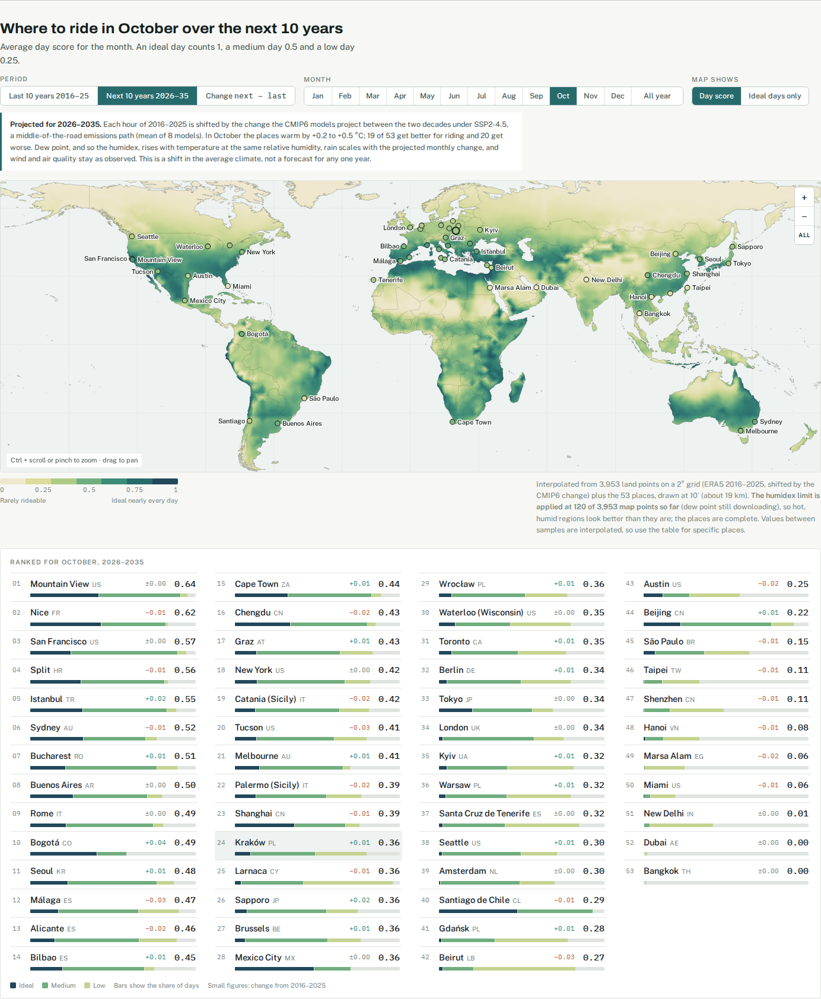
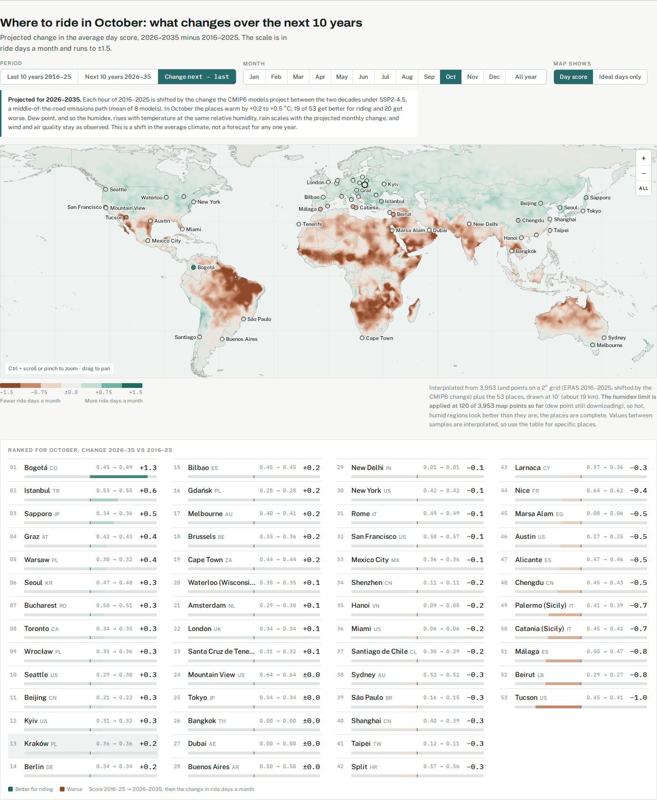

# Cycling Weather Atlas

A static page that answers "how often is the weather good for cycling here, in month X?"
It shows a world map, key places month by month, and a month report (anomaly) per place.

**Live version:** https://pmaciolek.github.io/weather/index.html

**Next 10 years** (2026–2035, CMIP6 SSP2-4.5 projection):



**Change** (next 10 years minus last 10, in ride days a month):



## Data sources (why these)

| Need | Source | Coverage | Notes |
|---|---|---|---|
| Hourly temperature, rain, wind (places) | Open-Meteo historical API (ERA5 / ERA5-Land reanalysis) | global, 1940 → ~yesterday | Free, no key. ERA5 is final about 5 days after real time; the latest days are preliminary analysis. |
| Hourly temperature, rain, wind (map) | Copernicus CDS, "ERA5 hourly time-series data on single levels" | global, 1940 → ~3 months ago | Free account, key in `~/.cdsapirc`, ERA5 licence accepted. One request per point, about 1 minute each. |
| Air quality | Open-Meteo air-quality API (CAMS) | Europe 2013→, global Aug 2022→ | European AQI, hourly. |
| Dew point (places) | Open-Meteo historical API (ERA5) | as above | Fetched separately (`dew` cache), so the weather cache stays valid. |
| Dew point (map) | Copernicus CDS, ERA5 hourly time-series (per point) | 1940 → ~3 months ago | `dew_grid.py fetch-ts`, ~10 h. A gridded 1° route (`fetch`) exists for when that queue is open. |
| Climate change (next 10 years) | Copernicus CDS, CMIP6 projections, SSP2-4.5, monthly `tas` and `pr` | 2015–2100 | 8 models, about 40 MB each. |

Hourly data is required because the rule is "at least 6 hours within a band", which
daily min/max can't answer. Baseline: **2016–2025** (10 recent years).

Rejected alternatives: weather-station data (GHCN/Meteostat) has gaps, uneven coverage
and no consistent hourly wind. Downloading gridded ERA5 fields would mean 10–40 GB even for a
coarse grid; the CDS time-series service returns one point's 10-year hourly series directly.

## Score

See `pipeline/score.py` (rules) and `pipeline/config.py` (thresholds, all adjustable).

* Riding hours: 06–22 local time, sun above the horizon.
* Ideal hour: 18–30 °C with wind ≤ 25 km/h. Medium hour: 12–18 or 30–33 °C, or an ideal temperature with wind of 25–40 km/h.
  Low hour: 4–12 °C (wind ≤ 40 km/h), or a medium-temperature hour with wind of 25–40 km/h.
* Heat and humidity cap an hour by its humidex (Environment Canada formula, from temperature and dew point):
  up to 25 no limit, 25–30 at best medium, 30–35 at best low, above 35 unusable. The warm, showery rule
  below only counts hours with a humidex of 35 or less.
* Dry day (< 1 mm rain while riding): **1** for ≥ 6 ideal hours, **0.5** for ≥ 6 ideal + medium hours,
  **0.25** for ≥ 6 ideal + medium + low hours, otherwise 0.
* Warm, showery day (1–10 mm rain while riding): **0.25** if ≥ 3 riding hours are dry and above 24 °C, otherwise 0.
* Ruled out (score 0): > 10 mm rain while riding, any riding hour with wind > 40 km/h, or a daytime mean European AQI ≥ 60 ("poor").
* Month score is the mean day score; "ride days" are the sum of day scores (0.6 ≈ 18 ride days in 30).
  Days without AQ data (outside Europe before Aug 2022) get an expected penalty: the share of
  poor-AQ days in that calendar month at that location.

## Next 10 years (projection)

The Period switch has three views: "Last 10 years" (observed), "Next 10 years" (projected) and
"Change" (projected minus observed, on a diverging scale). The map, ranking and month-by-month table all
follow it. The projection is the same 2016–2025 hours shifted by the projected change from
2016–2025 to 2026–2035 (delta-change method, `pipeline/projection.py`):

* CMIP6, SSP2-4.5, 8 models (MPI-ESM1-2-LR, MIROC6, MRI-ESM2-0, NorESM2-MM, CNRM-CM6-1, ACCESS-CM2,
  IPSL-CM6A-LR, EC-Earth3-CC). The ensemble mean is used.
* Pattern scaling, because one model run's change over a single decade is mostly noise. Each
  cell and calendar month is regressed on the model's global mean temperature over 2015–2100,
  then multiplied by the model's global warming between the two decades (a line fitted over
  2015–2050). The result is smoothed lightly across neighbouring months.
* Temperature is shifted. Dew point keeps the hour's relative humidity (Magnus formula), and the humidex follows. Rain is
  scaled by the monthly ratio, clamped to 0.8–1.25. Wind and air quality are unchanged.
* This changes the averages, not their variability: heatwaves become hotter by the same shift,
  not more frequent beyond it.

## Run

```bash
cd pipeline
python3.13 projection.py fetch          # CMIP6 tas + pr, 8 models (~15 min); `summary` prints the deltas
python3.13 build_cities.py              # places + month reports -> web/data/cities.json (Open-Meteo)
python3.13 build_grid.py fetch-wx       # ERA5 2° land grid via CDS (~3,950 points, ~20 h, resumable)
python3.13 build_grid.py fetch-aq       # CAMS air quality on a 4° grid via Open-Meteo (quota-limited, resumable)
python3.13 dew_grid.py fetch-ts         # ERA5 dew point per map point (~10 h, resumable)
python3.13 build_grid.py render         # score (observed + projected) + interpolate -> web/data/grid.json
python3.13 snapshot.py                  # one offline HTML file -> web/snapshots/cycling-weather-atlas-<date>.html
cd ../web && python3.13 -m http.server 8765   # open http://localhost:8765
```

Requires `numpy scipy pillow global-land-mask cdsapi netCDF4` (`pip install --user ...`).

**All year:** the month selector's "All year" option shows the mean of the twelve monthly values (map, ranking, table and change view; changes are then in ride days a year).

**Map rendering:** samples are interpolated linearly over a Delaunay mesh onto a 1/6° raster
(about 19 km), stored as greyscale PNGs inside `grid.json`, coloured in the browser and clipped
to the Natural Earth 1:50m coastline. The map zooms (Ctrl/Cmd + scroll, pinch, or the buttons).

**Fallbacks when Open-Meteo's quota is spent:** place weather comes from the CDS ERA5
time-series (about 6 days behind instead of 1), and place air quality is borrowed from the nearest
map AQ sample. Both are labelled on the page; the next run with quota available replaces them.

**Grid:** weather comes from the CDS time-series service, 2016–2025 hourly, one request per
point with 6 parallel workers. The CDS limits queued requests per dataset, and the fetcher waits
when the queue is full. ERA5 is in UTC; riding hours use local solar time. Air quality comes from
Open-Meteo on a coarser 4° grid (CAMS global only exists from Aug 2022; 2024–2025 are used). Its
monthly share of poor-air days is interpolated onto the weather points as an expected penalty.
Raw hourly series live in `cache/grid/wx/` and `cache/grid/aq/`. Scored climatologies are cached
per point and recomputed automatically when `score.py` or `config.py` changes. The fetcher
re-renders every 200 points; the places are blended into the map as extra samples.
Progress: `tail cache/grid_wx.log`.

**Month reports** (`cities.json → anomaly`): each of the last 13 months is compared with the same
calendar month in 2016–2025, over the same days for a month in progress. Metrics: ride days, day
score, mean temperature, rain total, mean daily peak wind and daytime EAQI, each with the
per-year baseline values, anomaly, z-score and rank. Re-run `build_cities.py` daily for current
data; the current year's cache refreshes once per day. Open-Meteo's free tier allows about 10k
weighted calls a day, so a full rebuild of all places can stall for a while on the hourly limit.

## Known limitations

* ERA5 is about 25 km resolution (ERA5-Land about 9 km for temperature). It smooths coastal
  microclimates and urban heat (San Francisco vs Mountain View still separate well).
* Wind is the hourly mean at 10 m, not gusts.
* The projection is a mean shift from a model ensemble under one scenario. Over 10 years,
  natural variability is as large as the projected change, so any single year can differ widely.
* CAMS air quality is a model at about 10 km (Europe) or about 40 km (global), so it under-represents
  street-level pollution peaks; desert ozone and dust can push it the other way (e.g. Tucson in spring).
* The map interpolates (inverse-distance) between points 2° apart, so mountains are blurred.
  Use the place table for specific places.

## Credits

* ERA5: Hersbach, H. et al. (2020), The ERA5 global reanalysis, Q. J. R. Meteorol. Soc. 146, 1999–2049, doi:10.1002/qj.3803.
* ERA5-Land: Muñoz-Sabater, J. et al. (2021), Earth Syst. Sci. Data 13, 4349–4383, doi:10.5194/essd-13-4349-2021.
* CAMS European air quality reanalyses/forecasts and CAMS global atmospheric composition forecasts.
* Open-Meteo: Zippenfenig, P. (2023), Open-Meteo.com Weather API, Zenodo, doi:10.5281/zenodo.7970649 (CC BY 4.0).
* CMIP6: Eyring, V. et al. (2016), Geosci. Model Dev. 9, 1937–1958, doi:10.5194/gmd-9-1937-2016;
  ScenarioMIP: O'Neill, B. C. et al. (2016), Geosci. Model Dev. 9, 3461–3482, doi:10.5194/gmd-9-3461-2016.
  The World Climate Research Programme and the modelling groups are acknowledged for producing and sharing their output.
* Natural Earth via world-atlas; global-land-mask (NOAA GLOBE); D3.

Contains modified Copernicus Climate Change Service information and Copernicus Atmosphere
Monitoring Service information. Neither the European Commission nor ECMWF is responsible for
any use that may be made of the information it contains.
